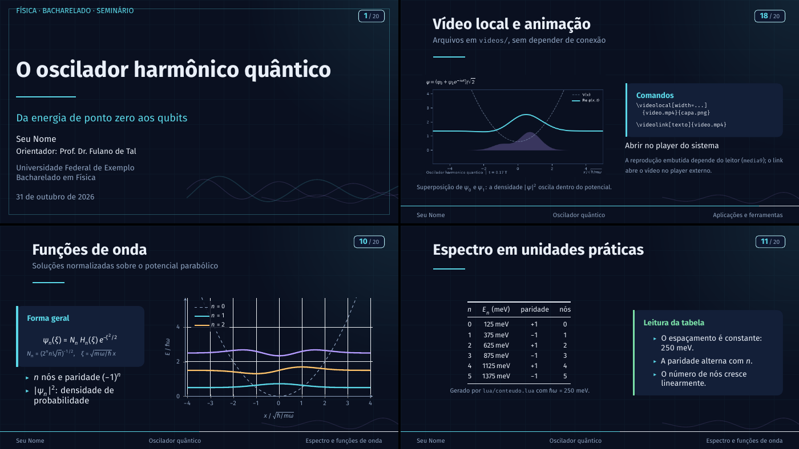

# Template de TFB em Física — ABNT + LuaLaTeX



Modelo de Trabalho Final de Bacharelado em Física baseado em `abntex2`, com
automação em Lua para dados, tabelas e gráficos. A apresentação Beamer 16:9
original continua disponível em um arquivo de entrada separado.

O documento principal é [`main.tex`](main.tex). Os capítulos ficam em
`capitulos/`, os materiais físicos reutilizáveis ficam em `content/`, os
módulos e dados automatizados ficam em `lua/` e `dados/`, e as referências
ficam em [`referencias.bib`](referencias.bib).

## Compilar

Compile a partir da raiz do projeto:

```bash
make
# ou
latexmk -lualatex main.tex
```

O TFB é gerado em `main.pdf`. Para também compilar a apresentação original:

```bash
make slides
# ou
latexmk -lualatex main-slides.tex
```

O PDF dos slides sai em `main-slides.pdf`. O alvo `make tfb` continua disponível
como atalho para gerar `main.pdf`. Para limpar os arquivos auxiliares:

```bash
make clean
```

O modelo acadêmico usa papel A4, fonte de 12 pt, margens da classe `abntex2`
e espaçamento de 1,5. Inclui capa, folha de rosto e aprovação, resumos,
listas, sumário, capítulos, referências numéricas e apêndice de exemplo.
Seções do conteúdo de slides foram adaptadas e incluídas nos capítulos do TFB;
os mesmos fragmentos continuam usados pela apresentação.

Use como referência as normas ABNT aplicáveis a trabalhos acadêmicos
(NBR 14724), citações (NBR 10520), referências (NBR 6023), numeração
progressiva (NBR 6024), sumário (NBR 6027) e resumo (NBR 6028), sempre na
edição vigente.

O `abntex2` automatiza a estrutura acadêmica e a formatação convencional,
mas não substitui a conferência das edições atuais das normas: a versão da
classe disponível na distribuição TeX pode anteceder revisões recentes.
Antes de entregar, confirme com o curso a edição vigente das normas ABNT e o
manual institucional. A ficha catalográfica, quando exigida, deve ser
fornecida pela biblioteca; não use os dados fictícios nem os textos de exemplo
como versão final do trabalho.

---

## Apresentação Beamer

O arquivo [`main-slides.tex`](main-slides.tex) mantém os slides originais do
Bacharelado em Física, com visual escuro ("lousa quântica"), tipografia Fira e
integração real entre **LaTeX** e **Lua**. O conteúdo de exemplo é sobre o
oscilador harmônico quântico.

Para compilar a apresentação, use `make slides`. Os demais exemplos de slides
permanecem em `content/` e a automação Lua é compartilhada com o TFB.

---

## Requisitos

- TeX Live com `lualatex`, `latexmk`, `abntex2`, `abntex2cite`,
  `babel-portuges`, `beamer`, `pgfplots`, `tcolorbox`, `siunitx`,
  `fontspec`, `unicode-math`, `listings`, `media9` e `animate`.
- **ffmpeg** (opcional): só para gerar o vídeo de demonstração ou extrair
  quadros para `\videoquadros`.
- Fontes **Fira Sans**, **Fira Math** e **Fira Mono** para a apresentação.
- **Lua 5.3+** apenas para regenerar os dados; a compilação usa o Lua embutido
  no LuaTeX.

No Arch Linux, por exemplo:

```bash
sudo pacman -S texlive-basic texlive-latexextra texlive-fontsextra lua
```

---

## Estrutura

```text
.
├── main.tex                  # entrada ABNT do TFB
├── main-slides.tex           # entrada da apresentação Beamer
├── capitulos/                # capítulos do TFB
├── content/                  # fragmentos compartilhados de Física
├── referencias.bib           # referências bibliográficas
├── fisica.sty                # macros e interface LaTeX → Lua
├── beamerthemefisica.sty     # tema visual dos slides
├── fisica-video.sty          # recursos de vídeo para os slides
├── lua/                      # constantes, tabelas e gráficos
├── dados/oscilador.csv       # dados usados pelo gráfico
├── scripts/gerar_dados.lua   # gera o CSV do oscilador
├── videos/                   # demonstração e imagem do oscilador
├── tools/                    # ferramentas auxiliares de mídia
├── .latexmkrc                # configura LuaLaTeX
└── Makefile
```

## Apresentação: personalização

Edite os metadados de slides no preâmbulo de `main-slides.tex`:

```latex
\title[Oscilador quântico]{O oscilador harmônico quântico}
\subtitle{Da energia de ponto zero aos qubits}
\author[Seu Nome]{Seu Nome\\[2pt]
  {\small Orientador: Prof.\ Dr.\ Fulano de Tal}}
\institute[UFXX]{Universidade Federal de Exemplo\\
  Bacharelado em Física}
\date{\today}
```

Cada `\section{...}` cria automaticamente uma página de seção. Os slides ficam
em `content/` e são incluídos em `main-slides.tex`.

---

## Documentação detalhada dos slides

As instruções de cores, tipografia, vídeos, módulos Lua e gráficos que seguem
aplicam-se à apresentação Beamer; os módulos Lua e os dados também são usados
no TFB.

### Numeração dos slides

O número aparece em um selo no canto superior direito, no formato
`atual / total`, em **todas** as páginas — inclusive capa, páginas de seção e
encerramento (que usam `[plain]`). O rodapé mostra autor, título curto e a
seção atual; a barra fina na base indica o progresso.

O total é lido do arquivo `.aux`/`.nav`, então a primeira compilação pode
mostrar `?` ou um total desatualizado. O `latexmk` roda o LaTeX quantas vezes
forem necessárias e resolve isso automaticamente.

Para mudar o visual do selo, edite o bloco `\node[...]` dentro de
`background canvas` em `beamerthemefisica.sty`.

### Cores e tipografia

Tudo o que é visual está em `beamerthemefisica.sty`. A paleta fica no topo:

```latex
\definecolor{fisicabg}{HTML}{0A1020}       % fundo
\definecolor{fisicacard}{HTML}{131F38}     % cartões
\definecolor{fisicacyan}{HTML}{5BD8E8}     % acento principal
\definecolor{fisicaviolet}{HTML}{B49CFF}   % acento secundário
\definecolor{fisicaamber}{HTML}{FFC46B}    % alerta
\definecolor{fisicagreen}{HTML}{7BE0A8}    % exemplo
```

As fontes são carregadas com `fontspec`/`unicode-math`:

```latex
\setsansfont{FiraSans}[...]
\setmonofont{FiraMono}[...]
\setmathfont{FiraMath-Regular.otf}
```

### Caixas disponíveis

```latex
\begin{destaque}{Título}
  Texto normal.
\end{destaque}

\begin{destaque}[fisicaamber]{Atenção}
  Versão âmbar.
\end{destaque}

\begin{equacao}
  \[ E = mc^2 \]
\end{equacao}
```

Também funcionam os blocos padrão do Beamer: `block`, `alertblock` e
`exampleblock`.

---

## Vídeos locais

Os comandos ficam em `fisica-video.sty` (já carregado no preâmbulo). Coloque os
arquivos em `videos/` e compile a partir da raiz do projeto.

### Incorporar na página

```latex
\videolocal[width=0.6\linewidth]{demo-oscilador.mp4}{demo-oscilador.png}
```

- `width`/`height` são opcionais; se só `width` for dado, a altura usa 16:9.
- O segundo argumento é o vídeo; o terceiro é a capa (poster). Se a capa for
  omitida ou não existir, o pacote desenha um botão de play.
- Se o vídeo não existir, aparece uma caixa vermelha com o caminho esperado,
  em vez de um erro de compilação.
- A incorporação usa `media9` (anotação RichMedia); se o pacote não estiver
  instalado, o cartão vira um link para o player externo. Para trocar a pasta:

```latex
\renewcommand{\fisicavideodir}{midia/}
```

### Abrir no player do sistema

```latex
\videolink{demo-oscilador.mp4}
\videolink[Abrir o vídeo]{demo-oscilador.mp4}
```

Gera um link `run:` clicável. É a alternativa mais portátil: o leitor de PDF
pede confirmação e abre o arquivo no player padrão do sistema.

### Animar quadros (sem Flash)

Para uma animação que funciona como conteúdo normal do PDF:

```bash
tools/extrair-quadros.sh videos/demo-oscilador.mp4 videos/demo-quadros 8 360
```

O script imprime a linha pronta, por exemplo:

```latex
\videoquadros[width=0.7\linewidth]{demo-quadros}{1}{40}
```

Os arquivos devem seguir o padrão `quadro-0001.png`, `quadro-0002.png`, …
(números com quatro dígitos). A taxa padrão é 12 quadros/s; ajuste com
`\renewcommand{\fisicafps}{8}`.

### Limitações de reprodução

A reprodução **embutida** depende do leitor de PDF:

| Leitor | `\videolocal` (media9) | `\videolink` | `\videoquadros` |
| --- | --- | --- | --- |
| Adobe Acrobat/Reader | depende da compatibilidade RichMedia/Flash | sim | sim |
| Okular | normalmente só a capa | sim (com confirmação) | sim |
| Evince | normalmente só a capa | depende da configuração | não |
| Navegadores | não | depende do visualizador | parcial |

Por isso o slide de exemplo oferece as duas opções: o vídeo incorporado e o
link para abrir no player do sistema. Para uma apresentação em que a reprodução
precisa ser garantida, prefira `\videolink` ou `\videoquadros`.

> O `media9` pode avisar “Temporary extra page added at the end” na primeira
> passagem. É esperado: a segunda passagem remove a página temporária. O
> `latexmk` cuida disso; ao compilar manualmente, rode o `lualatex` duas vezes.

O vídeo de exemplo foi gerado com:

```bash
python3 tools/gerar-video-demo.py
```

Requer `numpy`, `matplotlib` e `ffmpeg`. Ele usa H.264/yuv420p, formato mais
compatível com leitores de PDF.

---

## Interface LaTeX → Lua

Os comandos abaixo são definidos em `fisica.sty` e leem os módulos de `lua/`:

| Comando | O que faz |
| --- | --- |
| `\cte{hbar}` | `$\hbar = 1.054\,571\,817\times10^{-34}$ J s` |
| `\ctevalor{me}` | valor + unidade, sem o símbolo |
| `\cteunidade{c}` | apenas a unidade (`m/s`) |
| `\ctesimbolo{mp}` | apenas o símbolo (`$m_p$`) |
| `\tabelaconstantes{c,hbar,e,me,mp,kB}` | linhas prontas para um `tabular` |
| `\energia{0}{250}` | energia do nível `n` para `ħω = 250 meV` |
| `\roteiro` | itens do roteiro |
| `\comparacao` | linhas da tabela clássico × quântico |
| `\niveisTabela` | linhas da tabela de níveis |
| `\exercicios` | itens da lista de exercícios |
| `\plotOscilador` | `\addplot`s do potencial e de `ψ₀, ψ₁, ψ₂` |

Exemplo de uso em um slide:

```latex
\begin{frame}{Constantes}
  \begin{tabular}{@{}lll@{}}
    \toprule
    Símbolo & Valor & Grandeza \\
    \midrule
    \tabelaconstantes{c,hbar,e,me}
    \bottomrule
  \end{tabular}
\end{frame}
```

### Adicionar uma constante

Em `lua/constantes.lua`, acrescente uma entrada:

```lua
meuValor = {
  simbolo = "X",
  valor   = "1.234(5)e-6",
  unidade = [[\metre\per\second]],
  nome    = "minha grandeza",
},
```

O campo `valor` usa a sintaxe do `siunitx`; `1.234(5)e-6` significa
`(1.234 ± 0.005) × 10⁻⁶`. Depois basta usar `\cte{meuValor}`.

### Editar roteiro, tabelas e exercícios

Tudo fica em `lua/conteudo.lua`. Por exemplo:

```lua
M.roteiro = {
  { titulo = "Motivação", descricao = "Por que o modelo importa." },
  -- ...
}

M.exercicios = {
  {
    texto = [[Mostre que $[\hat x,\hat p]=i\hbar$.]],
    nivel = "nível 1",
  },
}
```

Os níveis de energia são gerados em um laço:

```lua
for n = 0, 5 do
  M.niveis[#M.niveis + 1] = {
    n        = n,
    energia  = (n + 0.5) * M.hbarOmegaMeV,
    paridade = (n % 2 == 0) and "+1" or "-1",
    nos      = n,
  }
end
```

### Dicas ao escrever Lua que gera LaTeX

- Prefira strings longas `[[...]]` para preservar as barras invertidas:
  `[[\hbar]]`, `[[\qty{1.0}{\metre}]]`.
- **Não** inclua `\n` nas strings enviadas a `tex.sprint`: o LuaTeX trata o
  caractere de nova linha como um glifo. Use espaços para separar comandos.
- Escape `%` como `\%` (o `%` inicia comentário no LaTeX).
- Números decimais devem sair com ponto, não vírgula; as funções do template
  já normalizam isso com `fmt()`.

---

## Dados CSV → gráfico

O gráfico de `content/05-funcoes-onda.tex` é montado em tempo de compilação:

1. `lua/fisica.lua` lê `dados/oscilador.csv`.
2. Cada coluna vira um `\addplot[...] coordinates {...};`.
3. O `pgfplots` desenha dentro do eixo definido no slide.

O CSV tem o formato:

```csv
x,V,psi0,psi1,psi2
-4.0000,8.0000,0.5001,1.4996,2.5017
...
```

Para recalcular os dados:

```bash
make dados
# ou
lua scripts/gerar_dados.lua
```

Para plotar outra coluna, edite `plotOscilador()` em `lua/fisica.lua`. As
funções `fisica.lerCSV(caminho)` e
`fisica.plotarColuna(dados, colX, colY, estilo, legenda)` também ficam
disponíveis para uso em `\directlua`:

```latex
\directlua{
  local d = fisica.lerCSV("dados/meus_dados.csv")
  fisica.plotarColuna(d, 1, 2,
    "draw=fisicacyan, line width=1.5pt, smooth", "minha curva")
}
```

---

## Solução de problemas

**`module 'fisica' not found`**
Compile da raiz do projeto. O arquivo `lua/instalar.lua` registra um buscador
para `./lua`; se você moveu `main.tex` para outra pasta, ajuste o caminho ou
compile com `latexmk -lualatex` a partir da raiz.

**`dados/oscilador.csv` não encontrado**
Rode `make dados` (ou `lua scripts/gerar_dados.lua`).

**`Fatal Package fontspec Error: ... requires XeTeX or LuaTeX`**
Você compilou a apresentação com pdfLaTeX. Use LuaLaTeX:

```bash
make slides
# ou
latexmk -lualatex main-slides.tex
```

No editor, selecione o motor LuaLaTeX (veja a seção [Compilar](#compilar)).
O arquivo `main.tex` também precisa ser compilado com LuaLaTeX para executar
as rotinas de dados e gráficos embutidas.

**`Package Listings Error: Couldn't load requested language`**
O `listings` define os dialetos Lua **5.0–5.3**. Use `language={[5.3]Lua}` no
estilo `lua` de `beamerthemefisica.sty`; não use `5.4`/`5.5`. O LuaTeX embute
Lua 5.4, mas o realce 5.3 é o mais próximo suportado pelo pacote.

**`File 'beamerthemefísica.sty' not found`**
Use o nome ASCII: `\usetheme{fisica}`. O arquivo é `beamerthemefisica.sty`;
acentos em nomes de arquivos funcionam no Linux, mas quebram em outros
sistemas e em alguns editores.

**O vídeo incorporado não toca**
Veja a tabela de limitações em [Vídeos locais](#vídeos-locais). Teste com
`\videolink` (abre no player externo) ou gere quadros e use `\videoquadros`.
Confirme também que o arquivo está em `videos/` e que a compilação foi feita
na raiz do projeto.

**Fontes Fira não encontradas**
Instale o pacote de fontes do TeX Live (`texlive-fontsextra` no Arch). Se
preferir outras fontes, troque as chamadas `\setsansfont`, `\setmonofont` e
`\setmathfont` em `beamerthemefisica.sty`.

**Erro do `babel`: opção `brazil` desconhecida**

O ABNTeX2 solicita a opção legada `brazil`. Nas versões recentes do Babel,
essa definição é fornecida pelo pacote adicional `babel-portuges`, que pode
não estar instalado por padrão. Instale o pacote de idiomas português do TeX
Live (no Arch Linux, `texlive-langportuguese`) e compile novamente. Não troque
`brazil` por `brazilian` no preâmbulo: a opção é solicitada internamente pela
classe ABNTeX2.

```latex
\usepackage{babel}
\babelprovide[import,main]{brazilian}
```

Se estiver usando uma versão antiga do Babel que não reconhece
`\babelprovide`, substitua o trecho acima por:

```latex
\usepackage[brazilian]{babel}
```

**Overleaf**
Envie a pasta inteira (incluindo `lua/` e `dados/`), escolha
*Menu → Compiler → LuaLaTeX* e mantenha `main.tex` como documento principal.
Para compilar a apresentação, selecione `main-slides.tex` como documento raiz.

---

## Licença e uso

Use, modifique e distribua livremente este template em trabalhos acadêmicos.
Se ele ajudar, uma menção é bem-vinda — mas não obrigatória.
